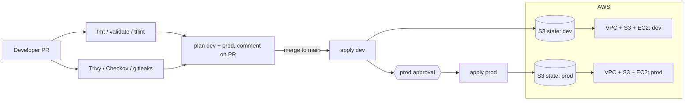

# tf-platform

A small but production-shaped Terraform repository on AWS: reusable **modules**, **remote state** with native
locking, **two isolated environments** (`dev`, `prod`), a **CI/CD pipeline with security scanning**, scheduled
**drift detection**, and a **failure drill** that deliberately breaks things so you can practise recovery.

> **Validation status.** Written without access to a Terraform binary or AWS account. It has **not** been run through
> `terraform validate`, the scanners, or a real apply. First steps on your side: `make fmt && make validate && make scan`,
> then expect to tweak scanner skip-lists and provider-version details. The drill doc says the same about its output.

## What you get

| Piece | Where | Notes |
|---|---|---|
| Remote-state bootstrap | `bootstrap/` | One versioned, encrypted, TLS-only S3 bucket per env; GitHub OIDC roles (plan + apply) |
| Reusable modules | `modules/network`, `storage`, `compute` | Typed, validated, documented variables; no provider/backend inside modules |
| Environments | `envs/dev`, `envs/prod` | Thin root modules: own backend key, own bucket, own tfvars |
| CI | `.github/workflows/terraform.yml` | fmt, validate, tflint, Trivy, Checkov, gitleaks, plan on PR, gated apply |
| Drift detection | `.github/workflows/drift.yml` | Nightly plan; opens an issue on exit code 2 |
| Drill | `scripts/drill/`, `docs/DRILL.md` | Drift, failed apply, stuck lock, state rollback, with recovery steps |

## Architecture



Each environment composes the same three modules:

- **network**: VPC, 2 public + 2 private subnets, IGW, optional single NAT, locked-down default SG, VPC flow logs
- **storage**: S3 bucket with versioning, SSE, public-access block, TLS-only policy, noncurrent-version lifecycle
- **compute**: one EC2 instance in a private subnet (IMDSv2, encrypted EBS, no inbound, SSM instead of SSH), least-privilege role to the bucket

## Layout

```
.
├── bootstrap/            # run ONCE per account: state buckets + CI roles (local state)
├── modules/
│   ├── network/  storage/  compute/     # versions.tf variables.tf main.tf outputs.tf
├── envs/
│   ├── dev/              # versions.tf (backend) providers.tf main.tf variables.tf dev.tfvars outputs.tf
│   └── prod/             # same shape, different values and stricter settings
├── scripts/drill/        # drift / failed apply / crash-lock scripts (dev only)
├── docs/DRILL.md         # recovery runbook
├── .github/workflows/    # terraform.yml, apply.yml (reusable), drift.yml
├── .trivyignore  .checkov.yaml  .tflint.hcl  .pre-commit-config.yaml
└── Makefile
```

## Quick start

Prereqs: Terraform `>= 1.10` (native S3 locking), AWS CLI, an AWS account (two for real isolation), and optionally
`tflint`, `trivy`, `checkov`, `terraform-docs`, `gh`.

### 1. Bootstrap state and CI roles (once)

```bash
cd bootstrap
terraform init
terraform apply -var 'github_repo=YOUR_ORG/tf-platform'
terraform output   # note state_buckets, plan_role_arns, apply_role_arns
```

Bootstrap deliberately uses **local state** (it creates the backend, so it can't use it). Keep
`bootstrap/terraform.tfstate` safe and **never commit it** (it's in `.gitignore`). Once you're comfortable you can
migrate it into one of the buckets with a `backend "s3"` block and `terraform init -migrate-state`.

### 2. Deploy an environment locally

```bash
export TF_STATE_BUCKET_DEV=$(terraform -chdir=bootstrap output -json state_buckets | jq -r .dev)
make plan  ENV=dev
make apply ENV=dev
```

`make` runs `terraform init -backend-config="bucket=..."`: the bucket name (which contains your account ID) is
injected at init time rather than committed. Prod works the same with `ENV=prod` and `TF_STATE_BUCKET_PROD`.

### 3. Wire up GitHub

Repository **variables** (Settings → Secrets and variables → Actions → Variables):

| Variable | Value |
|---|---|
| `AWS_PLAN_ROLE_DEV` / `AWS_PLAN_ROLE_PROD` | `plan_role_arns` outputs |
| `TF_STATE_BUCKET_DEV` / `TF_STATE_BUCKET_PROD` | `state_buckets` outputs |

Create **Environments** `dev` and `prod`; in each add environment variables `AWS_APPLY_ROLE` (matching
`apply_role_arns`) and `TF_STATE_BUCKET`. On `prod`, enable **Required reviewers**: that is the human approval gate.
No AWS secrets are stored anywhere; CI authenticates with short-lived OIDC credentials.

Also enable **branch protection** on `main` (require the `static`, `security`, and `plan` checks and a review).

## Design decisions

| Decision | Why | Trade-off |
|---|---|---|
| Directory per environment | Hard state isolation, explicit target, separate creds, envs can diverge | A little repeated wiring in each `main.tf` |
| Separate state bucket per env | Prod state readable only by prod roles; independent rollback | More buckets to manage |
| `use_lockfile = true` | No DynamoDB table to run | Needs Terraform ≥ 1.10 |
| Partial backend config | No account IDs in git | `-backend-config` needed at init (Makefile/CI do it) |
| Standalone SG rule resources | Per-rule diffs, no inline/standalone fights | Manual extra rules are invisible to plan (see DRILL "blind spot") |
| `ignore_changes = [ami]` | New AMI releases don't replace the instance | OS patching must be a deliberate rebuild |
| Plan role ≠ apply role | PRs can never mutate infra | Two roles per env to maintain |
| `apply` consumes the saved plan | What was reviewed is exactly what runs | Plan can go stale; apply fails safe and you re-plan |
| Environment hard-coded in each `main.tf` | Can't accidentally apply dev values with a prod name | One constant to keep in sync |

## CI pipeline

1. **static**: `terraform fmt -check`, `validate` for every root, `tflint` (AWS ruleset).
2. **security**: Trivy IaC scan (fails on HIGH/CRITICAL, SARIF uploaded to the Security tab), Checkov, gitleaks.
   Accepted findings are listed with reasons in `.trivyignore` and `.checkov.yaml`: **add a reason for every skip**.
3. **plan** (PRs): plans `dev` and `prod` using the read-only plan role; posts the plan as a PR comment.
4. **apply** (merge to `main`): `apply-dev` → `apply-prod` (needs approval). Plan is saved and applied verbatim.
5. **drift** (nightly): `plan -detailed-exitcode`; exit `2` opens an issue labelled `drift`.

Concurrency is set to *not cancel in-progress runs*: cancelling an apply is how stuck locks and partial applies happen.

## Security notes and honest limitations

- **Default apply role is `AdministratorAccess`** because these stacks create IAM roles and the exact set isn't known up
  front. Replace `apply_role_policy_arns` with a scoped policy before real use. This is the biggest gap.
- Dev and prod share one AWS account in this layout for simplicity. Real isolation = separate accounts
  (set `allowed_account_ids` in the tfvars to make Terraform refuse the wrong one).
- The dev instance has no outbound path (NAT off), so SSM Session Manager won't connect until you set
  `enable_nat_gateway = true` or add VPC endpoints. Prod enables NAT (~$30+/month: destroy when experimenting).
- S3 uses SSE-S3, not customer-managed KMS keys; flow-log group uses default encryption. Both are accepted skips.
- `terraform_remote_state` is intentionally unused; the three modules compose inside one root per env.
- Versions are pinned (`~> 5.80` AWS provider, Terraform `>= 1.10`, `.terraform-version`), commit `.terraform.lock.hcl`
  after your first `init` (it's not committed here because no `init` was run).

## Day-2 operations

```bash
make drift ENV=prod                # refresh-only plan, exit 2 = drift
terraform -chdir=envs/dev state list
terraform -chdir=envs/dev state pull > backup.tfstate   # before any state surgery
```

Refactoring without destroying anything: use `moved {}` / `import {}` / `removed {}` blocks in the env root
(see your notes, topic 8). Adding a new environment: copy `envs/dev`, change the hard-coded `environment`, add it to
`bootstrap` `environments`, re-apply bootstrap, add the GitHub Environment.

## The drill

`docs/DRILL.md` walks through deliberately causing **drift**, a **failed apply**, a **stuck lock**, and **bad state**,
and recovering from each. Run it in `dev` only; the scripts refuse any other environment.

## Cost

Dev (no NAT): a `t3.micro`, a few S3 buckets, CloudWatch logs: a few dollars/month. Prod adds a NAT gateway and
`t3.small`. Run `terraform destroy` in each env when done (dev buckets are `force_destroy`; prod's are not, empty
them first). Bootstrap buckets have `prevent_destroy`; remove that deliberately if you really want them gone.
